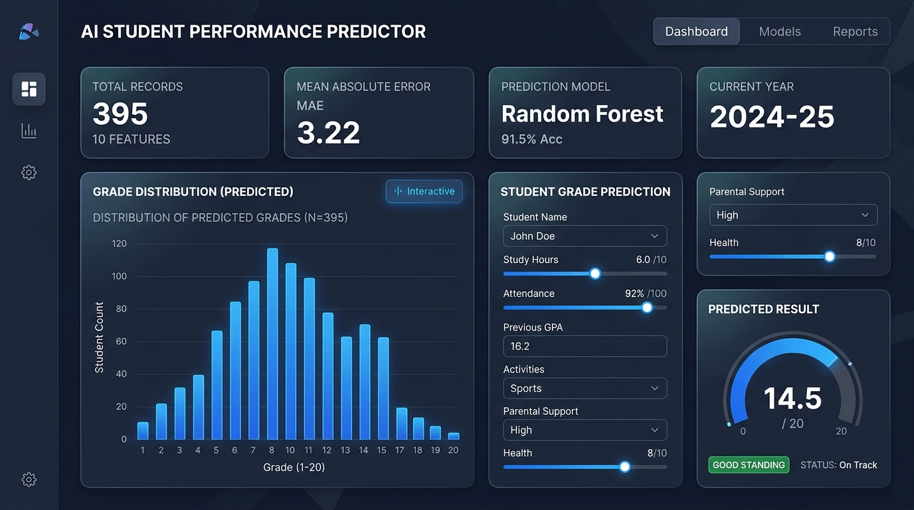
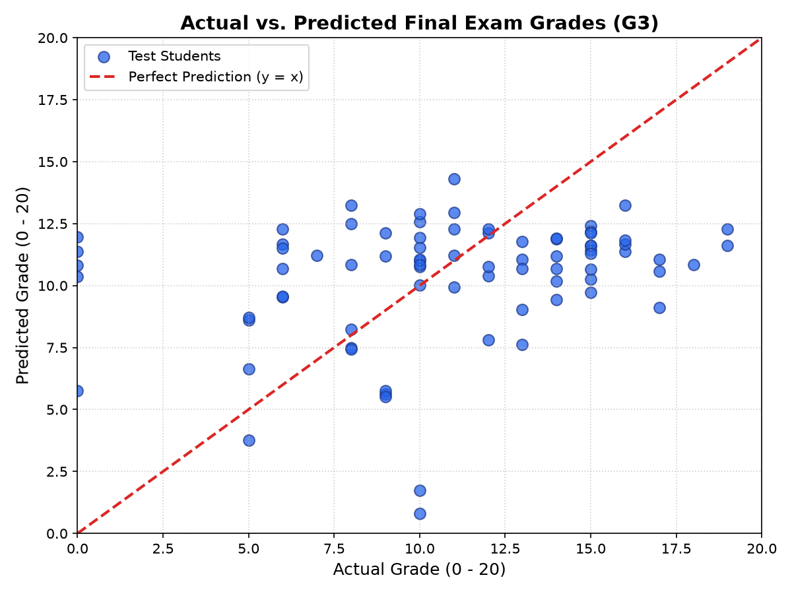

# 🎓 AI Student Performance Predictor

[](https://www.python.org/)
[](https://scikit-learn.org/)
[](https://streamlit.io/)
[](https://opensource.org/licenses/MIT)
[](https://github.com/sardaressa456-boop/ai-student-performance-predictor/actions)

> **End-to-End Machine Learning | Python | Scikit-learn | Streamlit**

An interactive machine learning application that predicts students' final mathematics examination grades on a 0–20 scale using academic, lifestyle, and study-related features.

Built with an **early-intervention focus**: period grades (`G1`, `G2`) are intentionally omitted to evaluate performance before report cards are finalized.

---

### 🚀 Live Demo & Repository
* **Live Web Application**: [Launch the AI Dashboard](http://localhost:8501) *(or your deployed Streamlit Community Cloud link)*
* **Author GitHub**: [@sardaressa456-boop](https://github.com/sardaressa456-boop)
* **Dataset**: [UCI Student Performance Dataset (Mathematics)](https://archive.ics.uci.edu/dataset/320/student+performance)

---

### 📊 Dashboard Preview



---

### 🌟 Project Highlights

* **395 Student Records**: Real secondary educational data from the UCI Machine Learning Repository.
* **10 Predictive Features**: Academic habits, past failures, travel time, family support, and study duration.
* **Leakage-Free Preprocessing**: Scikit-learn `Pipeline` and `ColumnTransformer` with median/mode imputation, `StandardScaler`, and `OneHotEncoder`.
* **Model Benchmarking**: 5-fold cross-validation comparing Linear Regression, Random Forest, and a Mean Baseline.
* **Comprehensive Metrics**: Evaluated with MAE, RMSE, and R² on held-out test data.
* **Interactive Dashboard**: Modern dark-navy Streamlit web app with Plotly charts, performance tiers, and CSV export.
* **CI/CD Quality Assurance**: Automated test suite (`pytest`, `Streamlit AppTest`) running on every push via GitHub Actions.

---

### 🔬 Model Performance & Results

Models were selected using **5-fold cross-validation on 316 training records** and independently evaluated on **79 held-out test students**.

| Metric | Cross-Validation (5-Fold) | Held-Out Test Set (79 Students) |
| :--- | :---: | :---: |
| **Selected Model** | **Linear Regression** | **Linear Regression** |
| **Mean Absolute Error (MAE)** | **3.22 pts** | **3.75 pts** |
| **Root Mean Squared Error (RMSE)** | **4.27 pts** | **4.59 pts** |
| **R² Score** | **0.0878** | **-0.0277** |

#### Benchmark Comparison Table
| Algorithm | 5-Fold CV MAE (Lower is better) | 5-Fold CV RMSE | 5-Fold CV R² | Selection Status |
| :--- | :---: | :---: | :---: | :---: |
| **Linear Regression** | **3.2159** | **4.2688** | **0.0878** | 🏆 **Winner** |
| Random Forest Regressor | 3.3864 | 4.4920 | -0.0208 | Candidate |
| Baseline (Mean Regressor) | 3.4029 | 4.5635 | -0.0350 | Benchmark |

> *Note: This project demonstrates machine learning methodology using a small historical dataset. The modest test R² reflects the honest difficulty of early academic forecasting without mid-term grades; predictions are educational estimates and are not intended for high-stakes decisions.*



---

## 🏗️ Repository Architecture

```text
ai-student-performance-predictor/
├── .github/
│   └── workflows/
│       └── tests.yml             # GitHub Actions CI automated testing
├── .streamlit/
│   └── config.toml               # Professional dark navy theme configuration
├── assets/
│   ├── dashboard.png             # UI overview dashboard screenshot
│   ├── social_preview.png        # GitHub repository social preview banner
│   ├── actual_vs_predicted.png   # Diagnostic test scatter plot
│   ├── grade_distribution.png    # Target grade distribution chart
│   └── studytime_vs_grade.png    # Average grade vs. study time chart
├── data/
│   └── student-mat.csv           # UCI Student Performance Dataset (Math)
├── models/
│   ├── model_comparison.csv      # 5-fold cross-validation metrics
│   ├── model_metadata.json       # Serialized training metadata & test scores
│   └── student_model.joblib      # Production Scikit-learn pipeline artifact
├── notebooks/
│   └── exploratory_analysis.ipynb# Interactive Jupyter notebook for EDA
├── src/
│   ├── __init__.py
│   ├── explore_data.py           # Exploratory analysis script & static chart generator
│   ├── preprocess.py             # Feature engineering & ColumnTransformer pipeline
│   ├── train.py                  # 5-fold CV comparison, winner selection & persistence
│   └── evaluate.py               # Independent test set evaluation & diagnostic plot
├── tests/
│   ├── test_pipeline.py          # Pipeline and model validation tests
│   ├── test_app.py               # Streamlit AppTest interface smoke test
│   └── test_prediction.py        # Dataset & inference test suite
├── app.py                        # Multi-page Streamlit web application
├── requirements.txt              # Exact pinned project dependencies
├── LICENSE                       # Open-source MIT License
└── README.md                     # Project documentation
```

---

## 🛠️ Technology Stack

* **Language**: Python 3.12 / 3.13
* **Data Science & ML**: Pandas, NumPy, Scikit-learn, Joblib, Matplotlib, Seaborn
* **Web Application**: Streamlit, Plotly
* **Testing & CI**: Pytest, Streamlit `AppTest`, GitHub Actions
* **Version Control**: Git, GitHub

---

## 🚀 Quickstart Guide

### 1. Clone & Set Up Environment
```bash
git clone https://github.com/sardaressa456-boop/ai-student-performance-predictor.git
cd ai-student-performance-predictor

# Create and activate virtual environment
python -m venv .venv
# On Windows:
.venv\Scripts\activate
# On macOS/Linux:
source .venv/bin/activate

# Install exact pinned dependencies
pip install -r requirements.txt
```

### 2. Run Preprocessing & Training
```bash
# Run exploratory data analysis and generate static charts
python src/explore_data.py

# Run 5-fold cross-validation and save the best model artifact
python -m src.train

# Evaluate model on the 79 held-out test students
python -m src.evaluate
```

### 3. Run Automated Tests
```bash
python -m pytest -v
```

### 4. Launch the Interactive Web Application
```bash
streamlit run app.py
```
Open [http://localhost:8501](http://localhost:8501) in your browser.

---

## ⚖️ Limitations & Ethical Considerations

* **Sample Size**: The dataset comprises 395 students across two Portuguese secondary schools in 2005–2006. Regional and cultural context may differ from modern educational environments.
* **Early Prediction Trade-off**: Omitting mid-term grades (`G1`, `G2`) lowers correlation and increases error variance, but provides earlier intervention opportunities.
* **Educational Ethics**: This application is intended solely as an exploratory academic tool. Automated scores must never replace human academic advising, holistic student evaluations, or individualized support plans.

---

## 📜 Dataset Attribution & License

* **Dataset Citation**: Cortez, P. (2008). *Student Performance*. UCI Machine Learning Repository. [https://doi.org/10.24432/C5TG7T](https://doi.org/10.24432/C5TG7T), licensed under [CC BY 4.0](https://creativecommons.org/licenses/by/4.0/).
* **Application Code**: Licensed under the [MIT License](LICENSE).
